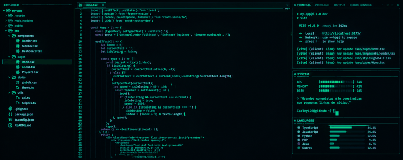

# 👨🏻‍💻 Iarley Gabriel

  

  <strong>Desenvolvedor Full Stack</strong>
   
  Desenvolvendo soluções através da tecnologia e do código.

---

### 🤖 Linguagens e Tecnologias

 

---

### 💻 Sistemas Operacionais

 

---

### 📊 Estatísticas

  

  

 
 
 

<picture>
  <source media="(prefers-color-scheme: dark)" srcset="https://raw.githubusercontent.com/iarley120/iarley120/output/pacman-contribution-graph-dark.svg">
  <source media="(prefers-color-scheme: light)" srcset="https://raw.githubusercontent.com/iarley120/iarley120/output/pacman-contribution-graph.svg">
  
</picture>
# 👨🏻‍💻 Iarley Gabriel

  

  <strong>Desenvolvedor Full Stack</strong>
   
  Desenvolvendo soluções através da tecnologia e do código.

---

### 🤖 Linguagens e Tecnologias

" />

 

---

### 💻 Sistemas Operacionais

 

---

### 📊 Estatísticas

  

  

 
 
 

<picture>
  <source media="(prefers-color-scheme: dark)" srcset="https://raw.githubusercontent.com/iarley120/iarley120/output/pacman-contribution-graph-dark.svg">
  <source media="(prefers-color-scheme: light)" srcset="https://raw.githubusercontent.com/iarley120/iarley120/output/pacman-contribution-graph.svg">
  
</picture>
